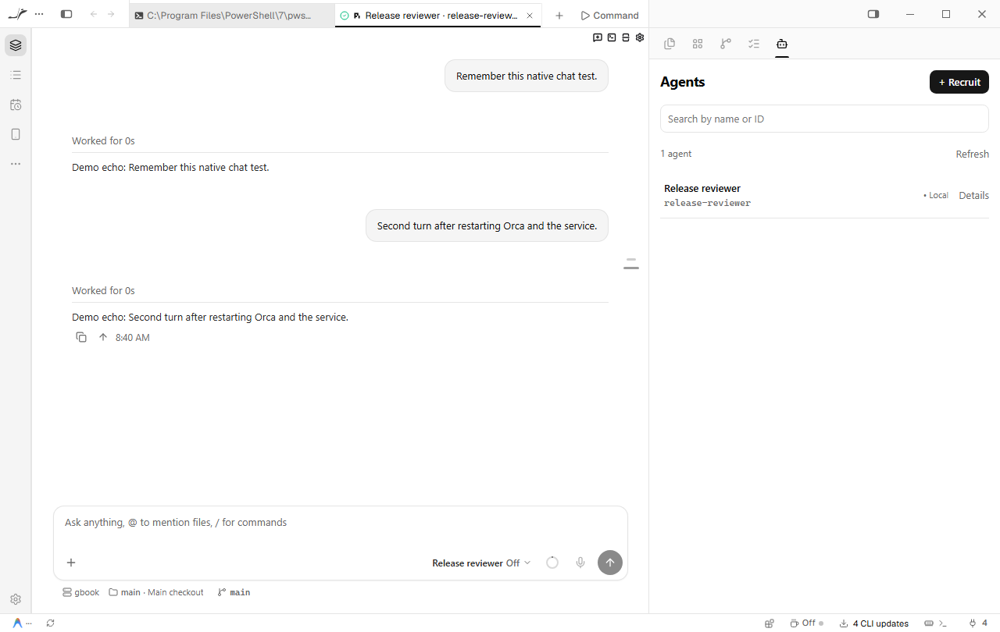
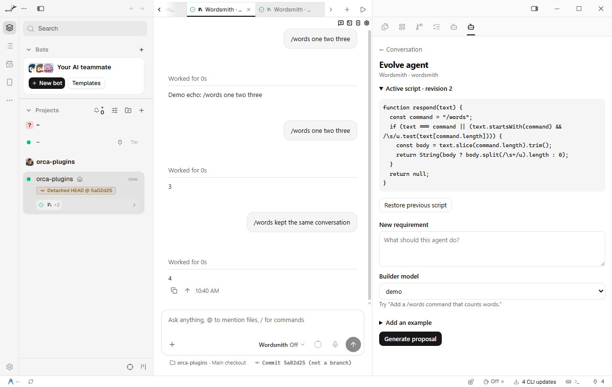
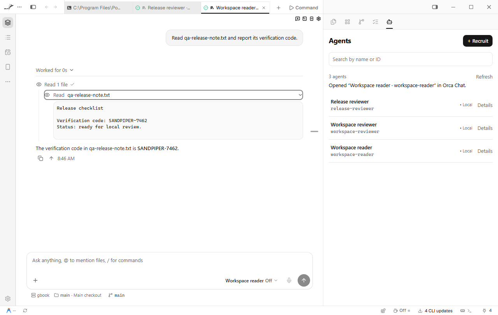

# Pi Durable for Orca

**Pi Durable** adds an English agent roster to Orca. Select a locally managed agent to open its native **Pi Chat** tab in the current workspace. Its stable ID, instructions, model and conversation live in the local Pi Durable service. **Details** opens the saved history and profile in the sidebar.



## Install Pi Durable

The native chat setup was tested with Orca Desktop **1.4.278** for Windows, Node.js **24**, npm, Git and Pi Coding Agent **1.4.0**. Run Orca, Pi and the service on the same computer with the same OS user.

1. Install the Pi CLI if needed, then check that Pi appears under **Settings → Agents** in Orca.

   ```sh
   npm install -g @earendil-works/pi-coding-agent@1.4.0
   pi --version
   ```

2. Download the release, register its local provider with Pi, and start the service.

   ```sh
   git clone --branch pi-durable-v0.3.0 https://github.com/gvillarroel/orca-plugins.git
   cd orca-plugins
   pi install ./integrations/pi-durable-provider
   cd runtime
   npm ci
   npm start
   ```

   Pi loads the provider from this checkout, so keep the folder at the same path. Leave the service running while using agents. On subsequent starts, run `npm start` from `runtime/`. Press **Ctrl+C** there to stop it.

3. In Orca, open **Settings → Plugins** and add the marketplace `https://github.com/gvillarroel/orca-plugins.git`, ref `main`. Find **Pi Durable** in the **Orca Plugins** catalog, install it and review its permissions. The trusted worker reads the focused workspace, checks for an existing agent session and invokes Orca’s CLI to launch Pi Chat. It stores the session ID in the plugin’s private storage. [Orca marketplace guide](https://github.com/stablyai/orca/blob/v1.4.278/docs/reference/plugin-catalog.md)

4. Open a local workspace and select **Pi Durable** in the right sidebar. Click **+ Recruit**, enter a name such as *Release reviewer* and optionally set its ID to `release-reviewer`. Choose **demo**, then click **Recruit agent**. Type `Hello` in Orca’s central chat composer. The reply should be `Demo echo: Hello`. A launched tab shows **Pi** and model `pi-durable/release-reviewer`, which routes messages to that agent’s own history.

### Return to an agent

The roster lists the agent’s display name and ID. The first selection creates a native tab for that agent in the current workspace. Selecting the same agent again identifies its existing conversation. Click its named tab or reopen it from Orca’s **Session History**. Orca can restore the tab after a restart.

Use **Details → Edit** to change the name, instructions or backing model while retaining the ID and saved turns. **Details** also shows messages from the native tab and earlier sidebar conversations. The Orca tab displays the exchanges recorded in that native session. This matters when opening an existing agent in native chat for the first time or when working in another workspace.

### Upgrade an existing installation

Stop the local service, then run the following commands from the root of its checkout. Update Pi Durable from Orca’s **Settings → Plugins** and review its workspace and agent permissions.

```sh
git fetch origin tag pi-durable-v0.3.0
git switch --detach pi-durable-v0.3.0
pi install ./integrations/pi-durable-provider
cd runtime
npm ci
npm start
```

The service reopens the existing database in your home directory.

### Evolve a local agent

1. Open the agent's **Details → Evolve**. Enter the new requirement. For an offline example, choose the **demo** builder and enter `When I say "status", reply "ready"`.
2. Optionally expand **Add an example**. Enter `status` as the message and `ready` as the expected reply. Click **Generate proposal**. You can leave the panel and return to the pending request.
3. Inspect **Proposed script** and **Passed checks**. A separate Pi Durable conversation writes the agent's JavaScript function. The service runs the proposed code with your example, the author's examples, saved checks and unrelated control messages. A failed proposal leaves the active revision in place.
4. Click **Apply change**. Send `status` in the agent's existing native Pi Chat tab. You should receive `ready`. The selected agent keeps its ID and conversation. SQLite stores the active script and its checks across restarts.
5. To undo the most recent application, expand **Active script** and click **Restore previous script**. New messages use the restored behavior. Replies already in the transcript keep their original text.

The builder model can differ from the agent's chat model. The offline builder supports exact-phrase replies in English and Spanish and a word-count command such as `Add a /words command that counts words.` For other requirements, select a configured OpenAI or Anthropic builder. That provider receives the requirement, the current function and the examples, and may charge for generation. The author's conversation is separate from the target agent's chat history.

Each script implements `respond(text)`. It can return a reply or return `null` to pass the message to the agent's normal model and tools. The local service evaluates the script in an isolated QuickJS interpreter with time and memory limits. Requirements must be implementable from the input text. Filesystem operations, network requests and package installation are outside this interface. Messages with images follow the native model path.



The desktop run started with the original agent and verified the proposal before applying it. [Original chat](../../docs/pi-durable/evolution/01-before-evolution.png) · [Verified proposal](../../docs/pi-durable/evolution/02-verified-proposal.png)

### Delete a local agent

Open **Details → Edit → Delete agent…**, verify the name and stable ID, then confirm **Delete agent**. Wait for any active conversation turn or evolution to finish first. The agent disappears from the roster and its old tabs stop accepting messages. Its ID stays reserved so a saved tab cannot accidentally reach another agent. Deletion retires the profile. Existing records remain in Pi Durable's SQLite log and in Orca's session transcripts. External agents are managed by the service that registered them. [Deletion confirmation](../../docs/pi-durable/evolution/04-delete-confirmation.png) · [Surviving agent and its conversation](../../docs/pi-durable/evolution/05-control-after-deletion.png)

### Choose a model

| Model in the agent profile | Setup on the machine running the service |
| --- | --- |
| `demo` | Local text echo. Works offline. |
| `openai/gpt-4.1-mini` | Set `OPENAI_API_KEY` before starting the service. |
| `anthropic/claude-sonnet-4-6` | Set `ANTHROPIC_API_KEY` before starting the service. |

The roster’s model selector offers providers for which it finds a key. Restart the service and click **Refresh** after setting a key. The provider checks credentials and model access on the first request. A remote model receives the conversation, supported attachments, and the workspace instructions, tool definitions and tool results used in that native turn.

### Native chat controls

Orca owns the composer, tabs, transcript rendering, chat settings and session history. The provider connects the selected Pi model to Pi Durable. Text replies and usage come from the corresponding durable turn. A vision profile accepts images in the native composer, including PNG, JPEG, WebP and GIF (up to four images totaling 8 MiB per message). The demo model accepts text.

With a tool-capable profile, the service can request a tool offered by the current Pi session. Pi executes the tool in Orca’s workspace and displays the usual tool card. The service waits for its result before continuing the same turn. For example, ask it to read a file and report a value that only appears in that file. Use `@` in the composer to select a workspace file by name.



The screenshot comes from an end-to-end Windows test with the released Orca and Pi binaries. The file and its contents were real. A local test double supplied the model’s tool request and generated its final answer from the returned file contents. No paid model call was needed.

**Stop** ends Pi’s wait and asks the service to cancel that specific request. If the service cannot confirm cancellation, check **Details** for the final outcome. After an interrupted tool handoff, check the native tool history before starting another action.

A Pi session fork has its own Orca transcript and still talks to the agent ID selected as its model. Use a new agent ID for a separate durable history. Auxiliary operations that need their own model call, such as Pi’s manual context compaction, require a separate model. If the attachment picker still reflects the previous model after editing a profile, reopen the native tab. [Orca’s native launch options](https://github.com/stablyai/orca/blob/v1.4.278/src/cli/specs/agent-launch.ts) · [Pi’s custom providers](https://github.com/earendil-works/pi/blob/v1.4.0/packages/coding-agent/docs/custom-provider.md)

### Connect an existing external service

In **Settings → Plugins → Pi Durable**, set **External registry** to the absolute path of a local `durable-agents.json`. For example:

```json
{
  "version": 1,
  "services": [
    { "id": "team", "name": "My team", "configPath": "../service/config.json" }
  ]
}
```

The registry resolves `configPath` relative to the connections file. The service must implement the Pi Durable v1 local console API at `127.0.0.1` and keep its `console-token` in its own state directory. Click **Refresh**. Entries appear as `external:team/reviewer` and open in the sidebar. Their source service owns profile edits, storage and availability. External-only setups can skip the local service and the Pi provider.

## Storage and troubleshooting

- **Native chat setup.** With the local service running and at least one agent recruited, run `pi --list-models pi-durable`. Look for the exact agent ID. If it is missing, register the provider from step 2 in Pi’s active configuration and check that Orca launches that installation of Pi. The panel displays the launch error and provides access to the durable conversation.
- **Local service.** The default address is `127.0.0.1:47896`. If the port is in use, check whether the service is already running. Stored data is in `~/.pi-durable-orca/`. To back it up, stop the service and copy that directory. Keep `connection.json` private. It contains a local access token.
- **Interrupted delivery.** Retrying an unacknowledged create or send reuses the original request ID. The service deduplicates retries even after reopening SQLite.
- **Long conversations.** The sidebar shows a bounded preview and indicates when it is partial. The service retains the full history. A native reply is read from its exact submission, independently of the sidebar’s display limit.

The persistence and retry behavior were inspired by the durable-pi reference. Its device/session API differs from the local console API used by the external-registry integration. [durable-pi API](https://github.com/disler/durable-pi/blob/37165c619573dbaf425463038bbffecfe576beec/apps/dpi-backend/API.md)

## Development

After `npm ci` in `runtime/`, run these checks from the repository root:

```sh
npm --prefix runtime test
node --test tests/*.test.mjs
python tests/panel_browser.py
orca plugin validate plugins/pi-durable
orca plugin check plugins/pi-durable
orca plugin validate orca-catalog.json
```

The browser test requires Python, Playwright and Chromium. Set `PLAYWRIGHT_CHANNEL=chrome` to use an installed Chrome. To load a development copy, run `orca plugin dev load plugins/pi-durable` and follow Orca’s permission review. The development ID is `local.pi-durable` and the catalog ID is `gvillarroel.pi-durable`.

Each plugin lives under `plugins/<id>/`. After committing a plugin release, run `orca plugin release-entry plugins/<id>` and add the version, commit and content hash to the root catalog. [Orca plugin authoring](https://github.com/stablyai/orca/blob/v1.4.278/docs/reference/plugin-authoring.md) · [MIT license](../../LICENSE)
